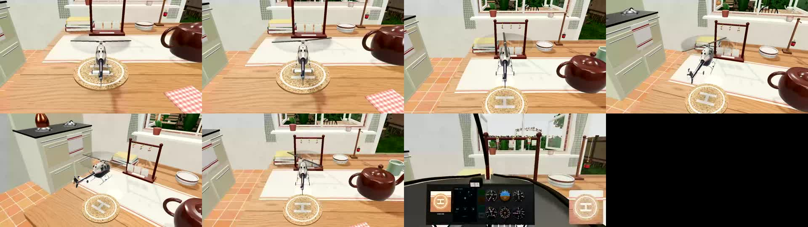
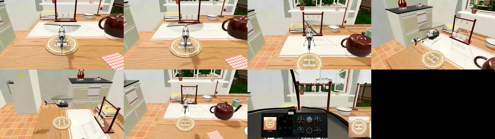
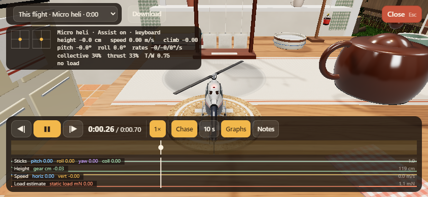
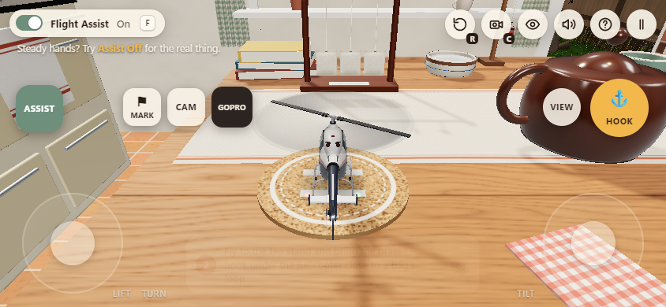

# Overnight before/after evidence

[Play Helicoptea](https://helicoptea.vercel.app/) · [Full results and limitations](../../OVERNIGHT-2026-10-15.md)

Starting build: `e50832db7ec1adf19a1957e8ebbb20f8fea74f14`. These are actual browser captures and
measurements, self-reviewed. Controller and phone input are emulated; physical-device acceptance remains
open. Files are copied unchanged from the run; [manifest](manifest.json) records source paths and hashes.

## Camera response

D-pad orbit previously depended on rendered frames. Measured yaw rates at requested 30/60/120 fps caps
were **0.725 / 1.329 / 1.360 rad/s**. The accepted fix (`da1037e`) holds **1.8 rad/s** using elapsed time,
preserving the original 60 Hz setting. Actual rendering during the probe was roughly 24–46 fps;
this is a control-consistency result, not a claim of 120 fps performance.

[Before clip, requested 30 fps](camera-before.webm) · [Accepted candidate clip, same request](camera-after.webm)

| Before filmstrip | After filmstrip |
|---|---|
|  |  |

[Baseline measurements](camera-before.json) · [Post-deployment measurements](camera-production.json)

## Invisible panels no longer intercept flight controls

At 844×390, tapping **Skip tips** hit an invisible crash-panel action and opened replay. After `b931ed2`,
the same coordinate tap dismisses tips and leaves flight active. A 40 px drag through the former hidden
panel changes camera yaw by **−0.24 rad**, versus **0** before. Visible crash/restart still works.

| Before: unintended replay | After: flight remains active |
|---|---|
|  |  |

[Baseline checks](touch-before.json) · [Post-deployment checks](touch-production.json)

## Milk discharge has its missing sound

The complete Skycrane mission filled through the snorkel, carried milk to the cup and opened its doors.
Before, **39.17 ml/s** of milk flow produced **zero** stream-channel input, gain and signal. After
`e25e4f2`, the same mission produced **39.18 ml/s** of audio input, **0.0136 RMS**, and silence after
emptying. Flight, fluid physics and sound synthesis were unchanged.

[Listen to the isolated repaired stream, 3.77 s](tank-after.webm)

The recording peaks at **−26.8 dBFS**. Waveform/signal inspection establishes routing, not human listening
quality. There is no baseline audio recording here; the baseline JSON records the zero signal.
[Before measurements](tank-before.json) · [After measurements](tank-after.json)

## Acceptance limits

The integrated `7867e82` runtime passed **520/520 headless** and **555/555 strict local browser checks**.
Hosted software-renderer CI remains failing, with timing/performance and functional observations detailed
in the full results. Physical phone, Steam Controller, haptics, listening quality and skilled acrobatic
flight still need hands-on testing. No flight tuning was silently adopted.
